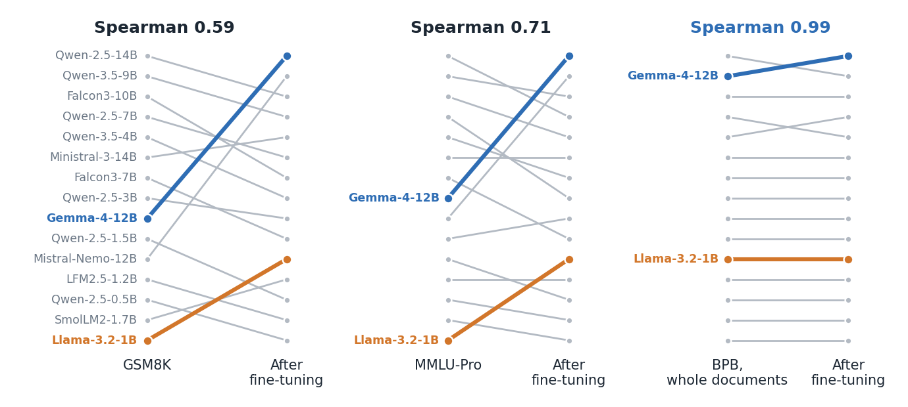

# Back to Entropy: Evaluating Base Language Models Beyond Perplexity and Benchmarks

[](https://github.com/DavidAfonsoValente/entropy-bench/actions/workflows/ci.yml)
[](https://github.com/DavidAfonsoValente/entropy-bench/releases/latest)
[](LICENSE)
[](paper_sota.pdf)

**To choose a base model to fine-tune, score each candidate on whole documents of fresh text from
your domain, in bits per byte.** No labels, no task and no training. Fifteen base models were
fine-tuned on a news-writing task: ranked this way beforehand, every one lands within one rank of
where it finishes, and 37 of 39 size-matched pairs are ordered as the fine-tuned systems order them.
GSM8K and MMLU-Pro order the same pairs at chance, and so do the models' own scores on the task
before any training (20 of 39): fine-tuning reorders the models, and the document reading predicts
the order they end in. HellaSwag orders 34.



*Each line joins a model's rank on a measure taken before fine-tuning to its rank after
fine-tuning on the news task (ROUGE-L on 500 held-out articles). Gemma-4-12B (blue) is ninth on
GSM8K and eighth on MMLU-Pro, and builds the best fine-tuned system; Llama-3.2-1B (orange) is last on
both and finishes eleventh. Document BPB on news places every model within one rank of its finish.*

**[Read the paper](paper_sota.pdf) · [Start in five minutes](docs/QUICKSTART.md) · [View the
leaderboard](LEADERBOARD.md) · [Understand a result](docs/RESULTS.md) · [Check the
dataset](docs/DATASET.md)**

## Two details decide whether it works

**The text has to be like the task's.** Scored on arXiv mathematics instead of news, the same fifteen
models are ordered correctly on only 23 of the 39 news pairs, below ranking by size. Which benchmark
the ranking agrees with follows the text as well: HellaSwag on news, Reddit and Hacker News, GSM8K
and MMLU-Pro on mathematics.

**Each document has to be read whole, from its own start.** A common convention joins the test set
into one stream and scores fixed-length blocks cut from it, so most blocks begin mid-document.
Scored that way the same news text puts Gemma-4-12B thirteenth of fifteen and orders 30 of the 39
pairs. Adapting every model briefly to the domain repairs the block reading; on whole documents it
barely changes the order.

## Why loss

A base model acquires its capabilities by minimising cross-entropy on text, and fine-tuning
minimises it again on the task. On shared text the difference between two models' expected losses
is the difference in their KL divergence from the text's distribution. Dividing by UTF-8 bytes
rather than tokens puts every tokenizer on one scale, and text dated after every model shipped
cannot have been trained on. Benchmarks are public: vendors optimise for the ones they report, and
their questions can leak into pre-training data.

## What it shows

Across seventeen base models (0.5B–35B) and four corpora:

- **Document BPB on the domain's text anticipates the fine-tuned ranking.** 37 of 39 size-matched
  pairs (0.949 [0.817, 1.000]); HellaSwag 0.872, parameter count 0.718, MMLU-Pro 0.513, GSM8K 0.474.
- **Blocks cut from a stream misrank strong models.** Gemma-4-12B is second on documents and
  thirteenth on blocks; the block reading orders 30 of 39.
- **No training is needed.** Adapting each model first lowers its loss by 2.0–7.9% on news and the
  two document rankings agree at Spearman 0.993.
- **The text has to be like the task's.** Mathematics text orders 23 of the 39 news pairs.
- **It is deterministic.** Re-running the document reading reproduces every model's BPB exactly.

## The method

The reading needs only forward passes: each held-out document is scored from its tokenizer's
beginning-of-document token with a 2,048-token context and a 1,024-token stride, on the same bytes
for every model (`compute_doc_bpb` in `lm_adapt_bench/evaluate.py`; `doc_bpb` in every result).
The pipeline can also adapt each candidate to the domain first, with a per-model Optuna search or
one shared recipe; the paper reports those readings in its appendix. Every number in the paper
recomputes from a committed artifact with `make check`.

## Pick your path

| I want to… | Start here | Hardware |
|---|---|---|
| Inspect and verify the published evidence | [Quickstart: path 1](docs/QUICKSTART.md#1-inspect-the-published-results--no-gpu-required) | CPU only |
| Evaluate a model on my own text | [Quickstart: path 2](docs/QUICKSTART.md#2-evaluate-a-base-model-on-your-corpus) | CUDA recommended |
| Add or request a leaderboard model | [Quickstart: path 3](docs/QUICKSTART.md#3-add-a-model-to-the-leaderboard) | None for a request |
| Verify an authorized copy of the paper corpus | [Dataset guide](docs/DATASET.md#verify-an-authorized-copy) | CPU only |
| Understand every result field | [Results guide](docs/RESULTS.md) | None |

## Install

Python 3.10 or newer is required. Install a PyTorch build suitable for your CUDA system first when
necessary.

```bash
git clone https://github.com/DavidAfonsoValente/entropy-bench.git
cd entropy-bench
python -m venv .venv
source .venv/bin/activate
python -m pip install --upgrade pip
python -m pip install -e .
```

Confirm the three public tools are available:

```bash
entropy-bench --help
entropy-dataset --help
entropy-leaderboard --help
```

## Evaluate models on your data

The recommended input is JSONL with one `{"text":"..."}` object per line. TXT, CSV, Hugging Face
datasets saved to disk, and ZIP files are also supported.

Inspect the corpus before allocating a GPU:

```bash
entropy-dataset describe /path/to/domain-corpus.jsonl
```

Score the candidates on whole documents. This is one forward pass per model:

```bash
entropy-bench \
  --models Qwen/Qwen2.5-0.5B meta-llama/Llama-3.2-1B \
  --dataset /path/to/domain-corpus.jsonl \
  --dataset-text-field text \
  --output results/my-domain \
  --contam-check-level strict \
  --contam-cleaning-mode global_unified \
  --baseline-only \
  --no-pdf
```

Each result records `doc_bpb`, the document reading (lower is better), beside `zero_shot_bpb`, the
block reading. Remove `--baseline-only` to also adapt every candidate with LoRA and report
`best_bpb`, the adapted block reading.

Adaptation hyperparameters come from one of two sources, and either way the final adaptation trains
until validation BPB stops improving (early stop on a plateau; with `--phase train` it resumes across
chained jobs, so a job's walltime never cuts it short). On a machine with no job time limit,
`--no-time-limit` runs the full method with no shortcuts: every sweep trial, then training until the
validation plateau with no wall-time budget and no epoch cap; the result records `stop_reason`, and
only `"plateau"` means validation BPB converged.

- `--hparams sweep` (default, the method): a per-model Optuna search (TPE sampler, successive
  halving on validation BPB) with the same `--n-trials` for every model and no wall-time cap, so
  no model is better tuned than another. `--sweep-time-fraction` adds a cap when walltime forces
  one; it lets small models finish more trials than large ones, so use it only when necessary.
- `--hparams manual`: skip the search and use `--hparams-file` (YAML/JSON of `TrainingConfig`
  fields). With no file it uses the packaged recipe `lm_adapt_bench/configs/manual_hparams.yaml`,
  the hand-picked configuration behind the paper's reported results.

Remove `--no-pdf` when
WeasyPrint's system libraries are installed. Model evaluation and adaptation require accelerator
hardware in proportion to model size; never launch a full run on an HPC login node.

Each run creates:

```text
results/my-domain/
├── <model>/result_<model>.json   # metrics and exact run configuration
├── contamination/               # findings, quarantine, clean split metadata
├── summary.json                 # consolidated machine-readable results
├── report.html                  # shareable report
└── report.pdf                   # optional PDF
```

See [Understanding results](docs/RESULTS.md) before comparing scores.

## Leaderboard and contributions

The [public leaderboard](LEADERBOARD.md) has two tracks over the same eleven base models, each its
own benchmark:

- **Mathematics** (`arxiv-math-2026-08-fixed-lora-v1`): arXiv `math.*` titles and abstracts from
  9 June to 20 August 2026, CC0 metadata, published in
  [`data/corpora/`](data/corpora/arxiv-math-2026.jsonl.gz). **Anyone can run it** and submit a model.
- **News** (`primary-news-2026-06-08-fixed-lora-v1`): the paper's primary corpus; its text cannot be
  redistributed, so the maintainers run requested models.

Canonical boards are [`results/leaderboard.json`](results/leaderboard.json) and
[`results/leaderboard_math.json`](results/leaderboard_math.json); the Markdown tables are generated
from them. Check them locally:

```bash
entropy-leaderboard validate
entropy-leaderboard render --check
```

[LEADERBOARD.md](LEADERBOARD.md) gives the exact commands to evaluate a model on the mathematics
track and turn the result into a self-checking submission; `prepare-submission` rejects a result
whose corpus hash, context length or adaptation recipe differs from the track's manifest. For the
news track, open a [model evaluation
request](https://github.com/DavidAfonsoValente/entropy-bench/issues/new?template=model-evaluation.yml).
See [CONTRIBUTING.md](CONTRIBUTING.md) for the evidence contract.

## Dataset and reproducibility

The exact paper corpus is identified by
[`benchmarks/primary-news-2026-06-08-fixed-lora-v1.json`](benchmarks/primary-news-2026-06-08-fixed-lora-v1.json): 119,054
documents, 366,564,042 file bytes, and SHA-256
`279ccc65a7f562e438cbe74827d41e51e41ac8783345250b6f85f607ea1a0162`.

The repository also publishes a complete record-level hash index, all reported metrics, and every
analysis artifact. The third-party news text itself is held pending redistribution permission; its
absence is a rights constraint, not a missing or unidentified experiment file. The [dataset
guide](docs/DATASET.md) explains the exact release condition and verification command.

Verify a permitted local copy with:

```bash
entropy-dataset verify /path/to/google_news_from_2026-06-08_to_2026-06-08_cleaned.jsonl
```

Published evidence includes:

- the corrected fixed-protocol leaderboard cells in `results/domain_transfer/news__*.json`;
- the legacy exploratory-run [summary](reports/11-model-run/summary.json), [HTML
  report](reports/11-model-run/report.html), [PDF report](reports/11-model-run/report.pdf), and plots,
  clearly separated from the headline ranking;
- all 33 cross-domain result cells in `results/domain_transfer/`;
- token-gain and byte-normalized position analyses in `results/token_gain*/`;
- static benchmark scores in `results/combined_bpb_vs_static.json` and the reproducible uncertainty
  and rank analysis in `results/static_benchmark_analysis.json`;
- the full corpus × tier × benchmark alignment matrix, selection regret, bootstrap intervals,
  benchmark-redundancy check, and tokenizer-bias bound in `results/alignment_matrix.json`
  (`tools/analyze_alignment_matrix.py`);
- the search records of an earlier, wall-time-capped HPO sweep in `results/legacy_sweep/`, which
  show why the sweep must give every model the same trial budget (see that directory's README);
- context-length result files in `data/context_length/`; and
- paper, slide, and speaker-script sources.

Run every lightweight release check with:

```bash
python -m pip install -e '.[test]'
make check
```

Build the paper and presentation with `make paper` and `make slides`. The MMLU-Pro, HellaSwag, and
GSM8K environment is documented separately in [eval/README.md](eval/README.md) because vLLM pins a
different PyTorch stack.

## The metric

For corpus cross-entropy in nats,

```text
BPB = (cross_entropy_nats / ln(2)) × (scored_tokens / source_utf8_bytes)
```

Lower BPB means the model assigned more probability to held-out text. The leaderboard ranks
**adapted BPB** on blocks, the reading every corpus has. The zero-shot-to-adapted reduction is reported separately as a corpus-calibration
diagnostic; a large reduction is not automatically a better final model.

## Project layout

```text
lm_adapt_bench/       the pipeline: config, data, contamination audit, sweep, adapt, evaluate, report
tools/                analysis, figure generators, and the reproducibility gates
docs/                 MAP.md (every file, generated) - STATUS.md (where things stand) - the ledger, plan and positioning
eval/                 standalone MMLU-Pro, HellaSwag and GSM8K harness
results/              committed artifacts and raw result cells; see docs/MAP.md
figures/              paper and slide figures, each produced by a tools/plot_*.py
benchmarks/           versioned benchmark contracts
data/manifests/       source-free record fingerprint indexes
reports/              rendered report of the superseded 11-model sweep
slurm/                Leonardo batch scripts - never run on the login node
slides/               team-talk deck and speaker script
paper_sota.tex        manuscript source; `make` builds paper_sota.pdf
LEADERBOARD.md        rendered public leaderboard
Makefile              every command this repo supports - start here
```

## Citation

GitHub exposes [citation metadata](CITATION.cff). Until an archival identifier is available:

```bibtex
@misc{valente2026backtoentropy,
  title        = {Back to Entropy: Evaluating Base Language Models Beyond Perplexity and Benchmarks},
  author       = {Valente, David Afonso},
  year         = {2026},
  howpublished = {\url{https://github.com/DavidAfonsoValente/entropy-bench}},
  note         = {Paper, code, benchmark artifacts, and leaderboard}
}
```

## License

Project code is released under [Apache-2.0](LICENSE). Model weights, external datasets, and benchmark
text remain subject to their original licenses and terms.
